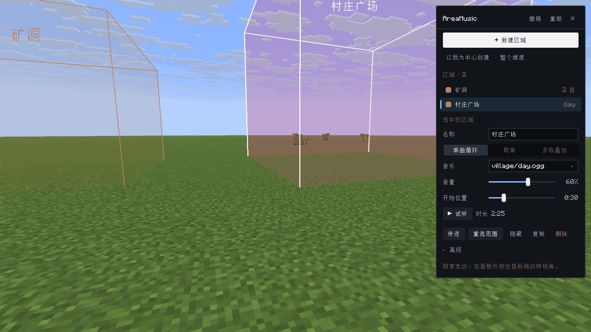
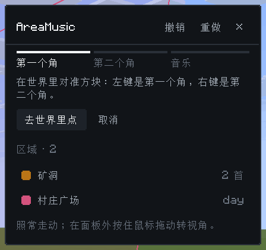
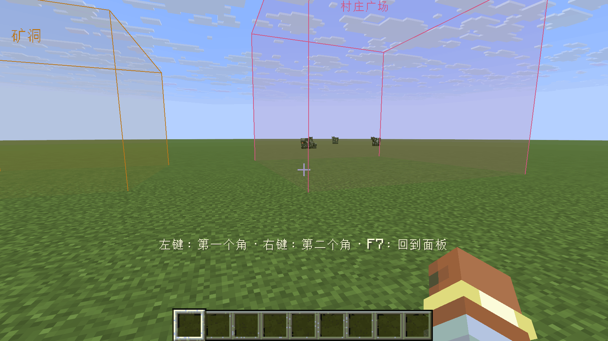
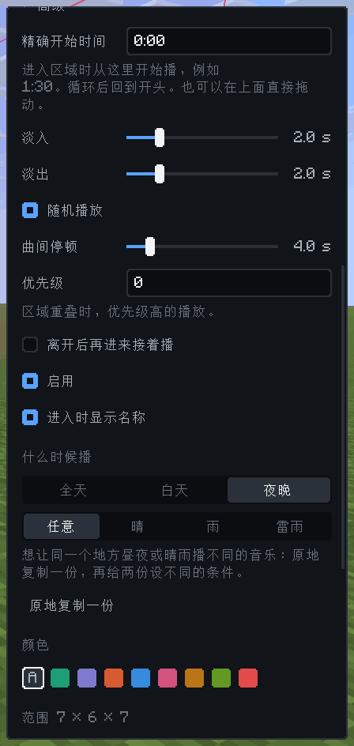
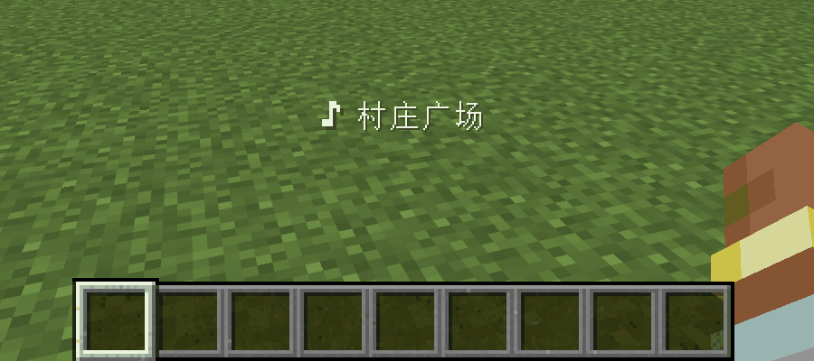
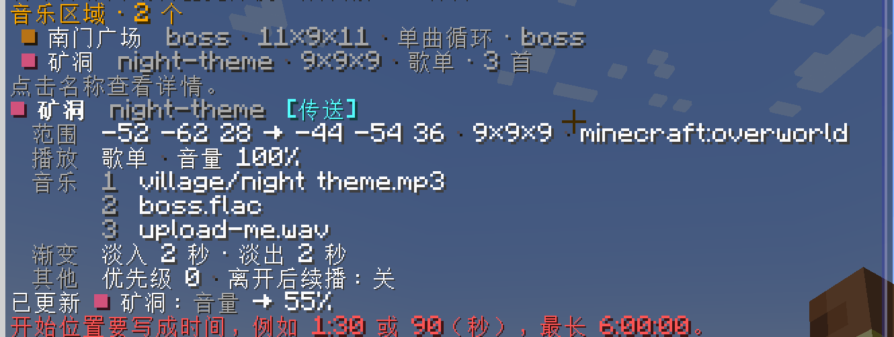

# AreaMusic

**在世界里画出一块区域，玩家走进去就听到你选的音乐。**

区域在游戏里直接画、直接调，音乐由服务器自动发给玩家。不用写 JSON，不用重载，玩家也不用自己放文件。

<p align="center">
  
</p>

> **English.** AreaMusic plays music inside areas you draw in the world. Areas are made and tuned with an in-game editor, and the server sends the audio files to players by itself. For Minecraft 1.20.1, 1.21.1 and 26.3 on Fabric, Forge and NeoForge.

> **当前是 2.0.0-beta.1 测试版。** 功能已经做完，但还没有经过大范围实际游玩；已知哪些部分验证过、哪些没有，见[更新说明](CHANGELOG.md)。遇到问题欢迎提 issue。

## 它能做什么

- **游戏里编辑**：按 `F7` 打开面板，点两个角画出区域，选一首音乐，完成。
- **自动分发**：音乐放在服务器上，玩家加入时自动下载，只下一次。
- **三种播放方式**：单曲循环、歌单（可随机、可留曲间停顿）、多轨叠加。
- **从哪里开始播由你定**：像播放器一样拖动进度条，随时点“试听”。
- **看时间看天气**：同一个地方白天、夜晚、雨天可以各播各的。
- **不止长方体**：一个区域可以由多个盒子拼成，也可以覆盖整个维度当背景音乐。
- **命令齐全**：面板能做的事，命令也都能做。
- 装了 [Axiom](https://axiom.moulberry.com/) 的话，它的工具栏里会多一个 AreaMusic 工具。

## 三步上手



1. 按 `F7` 打开编辑器，点 **新建区域**。面板会让开，让你看清世界。
2. **左键**点一个角，**右键**点另一个角。点完面板自己回来。
3. **选一首音乐**，或者直接把音频文件拖进游戏窗口。

改动立刻生效并自动保存。

想更省事：**以我为中心创建** 不用点角；**整个维度** 给当前维度配一首背景音乐。

<br clear="right">

<p align="center">
  
</p>

## 安装

| Minecraft | Fabric | Forge | NeoForge | Java |
| --- | --- | --- | --- | --- |
| 1.20.1 | Loader 0.19.3 + Fabric API 0.92.11 | 47.4.22 | 47.1.x（用 Forge 的 JAR） | 17 |
| 1.21.1 | Loader 0.19.3 + Fabric API 0.116.14 | 52.1.16 | 21.1.244 | 21 |
| 26.3 | Loader 0.20.1 + Fabric API 0.166.2 | 66.1.8 | 26.3.0.103 | 25 |

1. 在 [Releases](../../releases) 里按版本和加载器下载 `areamusic-<加载器>-<MC 版本>-<模组版本>.jar`。
2. 放进**服务端和每个客户端**的 `mods/`。单人游戏只放客户端。
3. Fabric 还需要 Fabric API；Forge 和 NeoForge 不需要别的前置。

服务端和客户端必须是同一个模组版本。

## 编辑器

`F7` 打开，再按一次、按 `Esc` 或点 `×` 关闭。需要管理员权限（默认等级 2），单人世界的房主始终可以用。

面板是右上角的一张悬浮卡片。它开着的时候：

- 世界照常运行，所有区域的盒子都画出来；游戏自己的快捷栏、血条和聊天会暂时隐藏。
- 你仍然可以**走动和飞行**；在面板以外**按住鼠标拖动**就能转视角。
- 撤销 `Ctrl+Z`、重做 `Ctrl+Y`。删除不弹确认，靠撤销恢复。

### 调一个区域

在列表里点一下区域就选中它，然后可以改：

| | |
| --- | --- |
| **名称** | 点进去直接输入，支持中文。按回车、`Esc` 或点别处都会保存 |
| **播放方式** | 单曲循环 · 歌单 · 多轨叠加 |
| **音乐** | 从服务器的音乐库里选，或把文件拖进窗口上传 |
| **音量** | 0–100% |
| **开始位置** | 拖动时间轴，玩家走进来时就从这里开始播；循环时回到开头 |
| **▶ 试听** | 不用走进去就能听。试听时改任何设置，会立刻按新设置重播 |
| **传送 · 重选范围 · 隐藏 · 复制 · 删除** | |

### 高级选项



默认折叠，平时用不到。

- **精确开始时间**：直接输入，如 `1:30` 或 `90`
- **淡入 · 淡出**
- **随机播放 · 曲间停顿**（歌单）
- **优先级**：区域重叠时数值高的播
- **离开后再进来接着播**
- **进入时显示名称**：走进有名字的区域时显示“♪ 区域名”
- **什么时候播**：全天 / 白天 / 夜晚，任意 / 晴 / 雨 / 雷雨
- **颜色**
- **范围**：两个角的精确坐标，以及更多的盒子
- **每条音轨**的音量、延迟和是否循环（多轨）

<br clear="right">

### 同一个地方，不同时候不同音乐

选中区域，在“什么时候播”下面点 **原地复制一份**，再把两份分别设成白天和夜晚（或晴天和雨天），各选各的音乐。人站着不动，天黑了音乐自己会换。

### 不规则的房间

房间不是一个长方体时，在“范围”里点 **+ 再加一块**，去世界里再点两个角。拼出来的几块算同一个区域，在里面走来走去音乐不断。

### 几个区域都符合时，谁播

依次比较：**优先级**高的 → **条件**更具体的（天气比时段具体，雷雨比雨具体）→ **范围**小的。整个维度的背景音乐范围最大，所以总是让位。

<p align="center">
  
</p>

## 音乐

支持 `.ogg`、`.mp3`、`.wav`、`.flac`。

- **添加**：把文件拖进游戏窗口，或放进服务器的 `areamusic/` 文件夹，几秒内就会出现在列表里。
- **分发**：玩家加入时自动核对，只下载本地没有的，按内容缓存，同一个文件只下一次。
- **音量**：游戏主音量 × 声音设置里的 AreaMusic 音量 × 区域音量。
- **原版背景音乐**：区域音乐播放时会自动停下，不会叠在一起；唱片机和音符盒不受影响。

服务器对自己分发的音乐负有版权责任。

## 命令

需要权限等级 2。只输入 `/areamusic` 会列出全部命令，点一条就填进聊天栏。

<p align="center">
  
</p>

| 命令 | 作用 |
| --- | --- |
| `/areamusic list` | 列出所有区域 |
| `/areamusic info <区域>` | 查看一个区域的全部设置 |
| `/areamusic create <区域> <角1> <角2> <音乐>` | 新建区域 |
| `/areamusic set <区域> <设置> <值>` | 修改一项设置 |
| `/areamusic music add\|remove <区域> <音乐>` | 增减曲目 |
| `/areamusic box add <区域> <角1> <角2>` | 再加一块范围 |
| `/areamusic box remove <区域> <编号>` | 移除一块范围 |
| `/areamusic tp <区域>` | 传送到区域 |
| `/areamusic delete <区域>` | 删除区域 |
| `/areamusic reload` | 重新读取区域文件和音乐文件夹 |

<details>
<summary><code>set</code> 可以改的全部设置</summary>

| 设置 | 值 | 说明 |
| --- | --- | --- |
| `name` | 文字 | 显示名称 |
| `volume` | `0`–`100` | 音量 |
| `mode` | `loop` `playlist` `layers` | 播放方式 |
| `start` | `1:30`、`90`、`1:02:03` | 开始位置，最长 6 小时 |
| `fadein` `fadeout` | 毫秒 | 淡入、淡出 |
| `shuffle` | `true` `false` | 随机播放（歌单） |
| `gap` | 秒 | 曲间停顿（歌单） |
| `time` | `any` `day` `night` | 时段 |
| `weather` | `any` `clear` `rain` `thunder` | 天气 |
| `priority` | 整数 | 优先级 |
| `resume` | `true` `false` | 离开后再进来接着播 |
| `enabled` | `true` `false` | 启用 |
| `announce` | `true` `false` | 进入时显示名称 |
| `color` | `#RRGGBB` `auto` | 盒子颜色 |
| `wholedimension` | `true` `false` | 覆盖整个维度 |
| `pos1` `pos2` | 坐标 | 第一块范围的两个角 |

</details>

## Axiom

在 Fabric 上同时装了 Axiom 时，它的工具列表里会多一个 AreaMusic 工具，面板内容与内置面板相同：右键点方块放置角点，右键点空处选中区域，`Delete` 删除。

Axiom 只有 Fabric 版，所以 Forge 和 NeoForge 上没有这个工具；内置编辑器在所有加载器上功能一样。

> 这个工具已针对 Axiom 的接口编译通过，但还没有在真实的 Axiom 上运行过。它没出现时日志里会有一条警告，内置编辑器不受影响。

## 服务器配置

`config/areamusic-server.properties` 在首次启动时生成，默认值适合大多数服务器。

| 选项 | 默认 | 说明 |
| --- | --- | --- |
| `distributeMusic` | `true` | 自动向玩家分发音乐 |
| `maxUploadMiB` | `32` | 单个上传文件的大小上限 |
| `maxLibraryMiB` | `1024` | 通过上传可达到的音乐库总大小 |
| `downloadKiBPerSecondPerPlayer` | `2560` | 每个玩家的下载限速 |
| `editPermissionLevel` | `2` | 使用编辑器所需的权限等级（0–4） |

## 参考

<details>
<summary>文件放在哪里</summary>

```text
<gameDir>/
├─ areamusic/                           音乐库（服务端）；玩家自备的同名文件（客户端）
├─ areamusic-cache/                     客户端下载缓存
├─ config/areamusic-server.properties
└─ <存档>/areamusic/areas/<区域>.json    区域定义，一个区域一个文件
```

区域跟着存档走，地图可以连同音乐区域一起打包分发（记得带上 `areamusic/` 里的音乐）。

</details>

<details>
<summary>区域文件格式（schema v4）</summary>

一般不需要手写。必填字段是 `dimension`、`pos1`、`pos2`、`playbackMode`，以及 `tracks`（多轨）或 `playlist`（歌单）。下面这些都是可选的：

| 字段 | 默认 | 说明 |
| --- | --- | --- |
| `displayName` | 空 | 显示名，最多 64 个字符 |
| `color` | 自动 | `#RRGGBB` |
| `enabled` | `true` | `false` 时保留但不播放 |
| `priority` | `0` | 优先级 |
| `resumeOnReenter` | `false` | 离开后再进来接着播 |
| `startOffsetMs` | `0` | 从第几毫秒开始播 |
| `time` | 不限 | `day` 或 `night` |
| `weather` | 不限 | `clear`、`rain` 或 `thunder` |
| `wholeDimension` | `false` | 覆盖整个维度 |
| `announce` | `true` | 进入时显示名称 |
| `extraBoxes` | 无 | 更多的盒子，每个是一对 `pos1`、`pos2`，最多 15 个 |
| `shuffle` | `false` | 歌单：随机顺序 |
| `gapMs` | `0` | 歌单：曲间停顿的毫秒数 |

v1、v2、v3 的文件仍可读取，重新保存时写成 v4。

</details>

<details>
<summary>从 0.x 升级</summary>

- 首次启动时，旧的 `config/areamusic/<saveId>/*.json` 会被复制转换到存档目录。旧文件保持原样，旁边多出一个 `MIGRATED.txt` 说明去向。
- 读不出来的旧文件会被跳过，并在日志和 `reload` 的输出里逐个列出。
- 0.x 的客户端和 2.x 的服务端互不兼容，需要一起升级。

</details>

<details>
<summary>已知限制</summary>

- 区域由长方体拼成（最多 16 块），没有球形或多边形。
- 人站在区域里时改音量、淡入淡出、曲间停顿，音乐不会中断；换曲目或改播放方式会重新开始。
- 人站在区域里时改开始位置，正在播的音乐不会跳过去，离开再进来才生效。想马上听到请用试听。
- 白天指从日出到可以睡觉之前，其余算夜晚。天气按整个世界算，不区分生物群系。
- 时间轴要先读出曲长，第一次选中区域时会晚一瞬间出现；音乐没下完时没有时间轴和试听。
- Axiom 的工具面板里没有试听按钮。
- 多人游戏下各玩家各自播放，彼此不保证帧级同步。

</details>

<details>
<summary>从源码构建</summary>

需要能下载 JDK 17、21、25 工具链（Gradle 会自动处理）。

```bash
./gradlew test check assemble build
```

8 个可安装的 JAR 在各加载器模块的 `build/libs/` 下，例如 `platforms/26.3/neoforge/build/libs/`。名字里带 `common`、`dev`、`sources` 的不是安装包。

代码分三层：`core` 是不依赖 Minecraft 的纯 Java（音频引擎、区域与编辑逻辑、同步协议、面板）；`platforms/<版本>/common` 是各版本的 Minecraft 适配；`platforms/<版本>/<加载器>` 只做事件接线和网络注册。

</details>

## 许可证

[MIT](LICENSE)。发布的 JAR 内嵌第三方音频解码库，其许可证见 JAR 内的 `META-INF/AREA_MUSIC_THIRD_PARTY_NOTICES.txt`。
